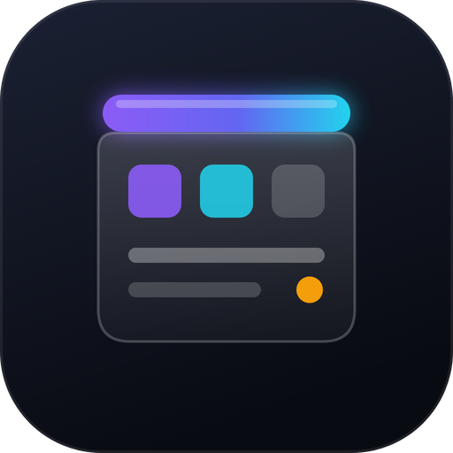
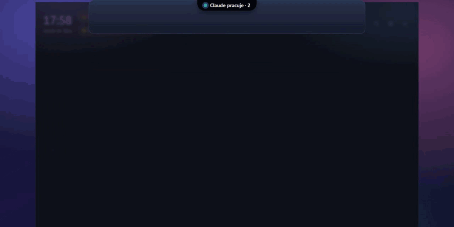
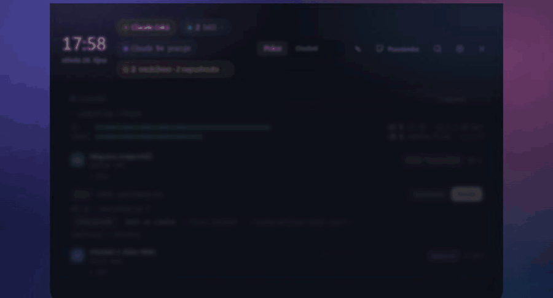
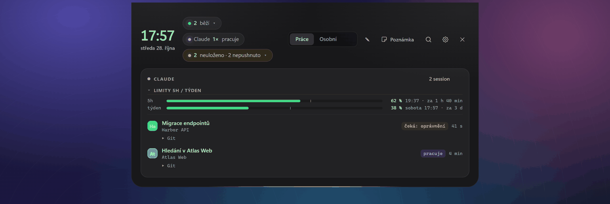
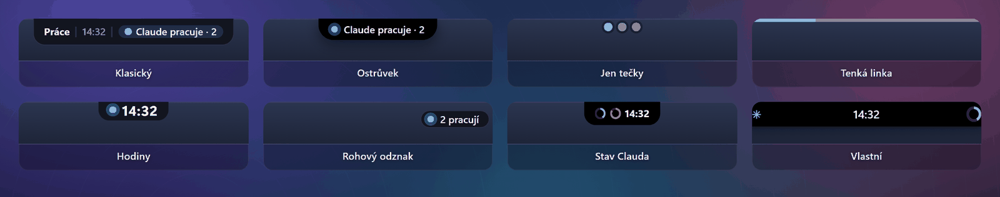
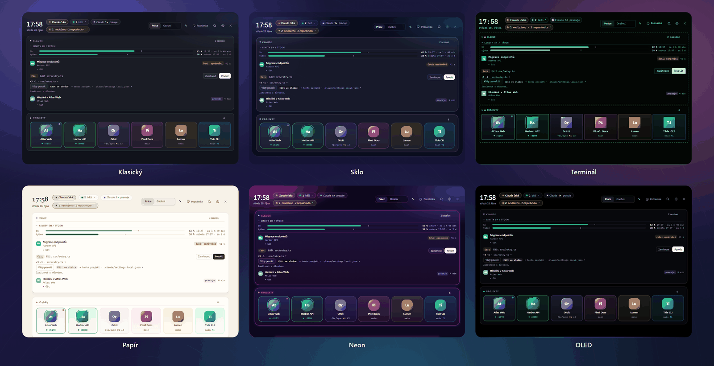
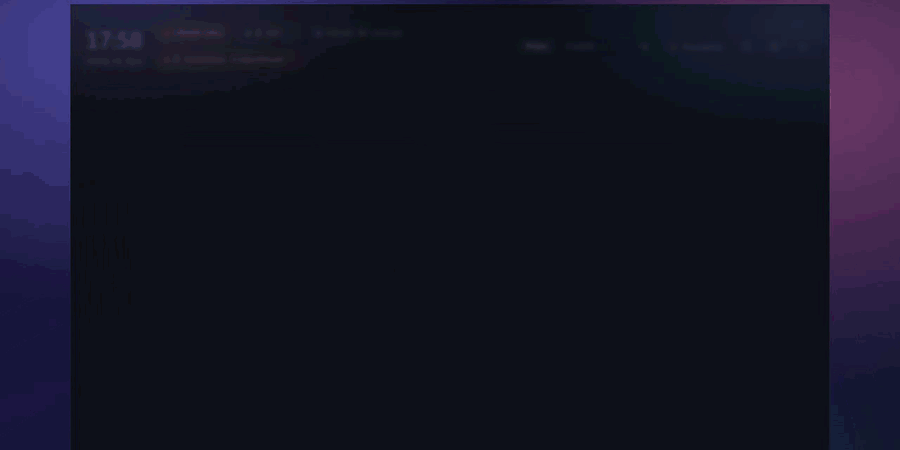
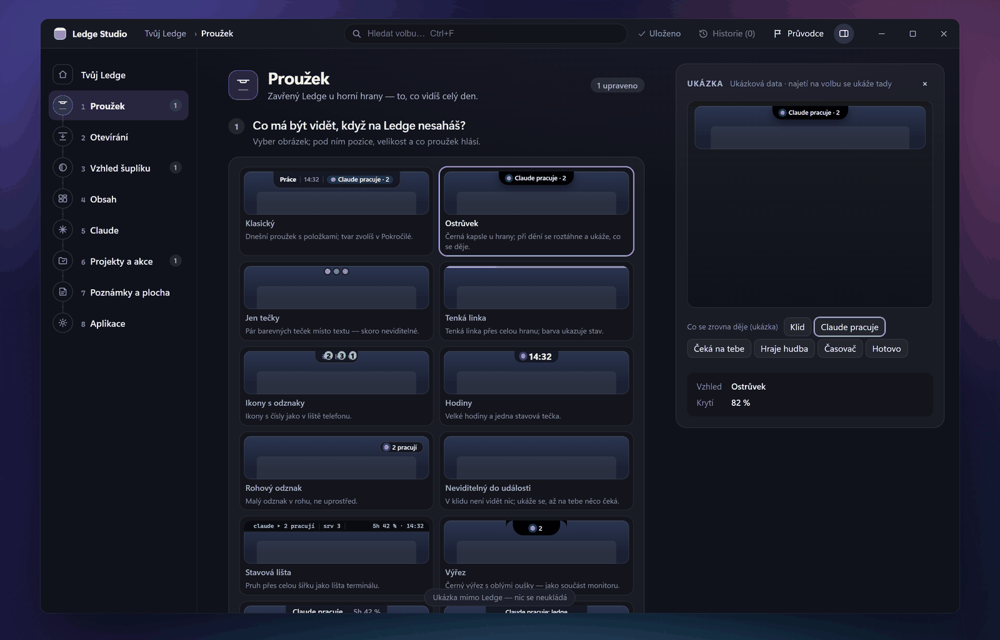
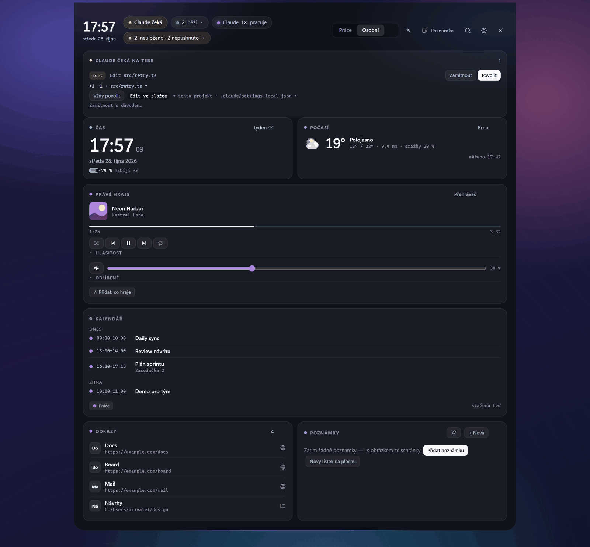

<div align="center">



# Ledge

**Celý pracovní den jeden pohyb myší od tebe.**
Šuplík u horního okraje obrazovky Windows — projekty, dev servery, poznámky, rychlé akce a všechny
session Claude Code se schvalováním, otázkami a limity, které vyřídíš bez hledání terminálu.

[](https://github.com/jiri-hyan/ledge-app/releases/latest)

[](https://github.com/jiri-hyan/ledge-app/releases/latest)
[](https://github.com/jiri-hyan/ledge-app/releases)
[](#instalace)
[](LICENSE)

[Web](https://jiri-hyan.github.io/ledge-app/?lang=cs) · [English](README.md) · [Instalace](#instalace) · [Otázky](#otázky) · [Pro agenty](AGENTS.md)



<sub>Skutečné rozhraní Ledge vykreslené s ukázkovými daty (vymyšlené projekty, nic osobního) na neutrálním pozadí.
Šuplík se vysune, když se myší dotkneš horního okraje obrazovky.</sub>


</div>

## Proč Ledge

Ledge staví jeden vývojář pro svou každodenní práci na Windows s Claude Code a sdílí ho jako open source
(MIT). Nesnaží se sedět každému hned po instalaci: má hodně nastavení, a když ti pořád nesedí,
[forkni si ho a uprav podle sebe](#uprav-si-ho).

- **Neruší.** Tenký proužek u horního okraje, dokud ho nepotřebuješ. Nikdy ti nevezme klávesnici, při hře
  na celou obrazovku mlčí a v klidu má rozpočet procesoru pod 0,1 %.
- **Claude Code konečně vidět i na Windows.** Všechny session na jeden pohled, schválení a otázky vyřízené
  ze šuplíku, limity 5h i týdne pořád na očích — bez přepínání mezi terminály.
- **Tvoje, lokální a otevřené.** Žádný účet, žádný cloud, žádná telemetrie. Poznámky jsou obyčejné soubory
  Markdown ve tvé složce, nastavení jeden JSON a kód je pod licencí MIT.

## Claude Code na Windows

Ledge se ke Claude Code připojí přes jeho oficiální hooky a stavový řádek. Když tě Claude potřebuje,
vysune se od horního okraje náhled — a editoru při tom nevezme fokus.





<sub>Ukázková data.</sub>

| | |
|---|---|
| **Schvalování** | Žádost o povolení ukáže příkaz nebo diff; **Povolit** nebo **Zamítnout** jedním klikem. Když neodpovíš včas, žádost se vrátí do terminálu. |
| **Otázky** | `AskUserQuestion` s jednou volbou, více volbami nebo vlastním textem. |
| **Plány** | Když chce Claude opustit plan mode, plán posoudíš: schválit, nebo vrátit s připomínkou. |
| **Session** | Každá session v počítači — aplikace i CLI, včetně subagentů — a její stav: čeká na tebe, pracuje, nečinná, nedokončená práce. Klik přepne do jejího okna nebo dokončenou session obnoví. |
| **Limity a tempo** | Spotřeba 5h a týdenního okna s odpočtem resetu (ze stavového řádku Claude Code; tvůj vlastní stavový řádek dál funguje), volitelná ryska tempa a připomínka, když se plné okno obnoví. |
| **Aktivita a útrata** | Co Claude právě dělá a odhad útraty v cenách API spočítaný z tvých lokálních přepisů. |
| **Nedokončená práce** | Soubory, které session změnila a nezacommitovala, a commity, které nejsou na žádném remote. |
| **Nastaví ho Claude** | Pošli Claudovi [návod](docs/pro-claude.md); přes MCP přidá tvoje projekty, odkazy a rozložení — až připojení zapneš. |

> **Schválit smí jen člověk.** Záměrně neexistuje API, nástroj MCP ani volba, přes kterou by za tebe
> schvaloval kdokoli jiný.

## Co umí

| | |
|---|---|
| **Projekty a dev servery** | Dlaždice na projekt: klik spustí dev server (`npm run dev`, porty, log) nebo aplikaci. Loga se najdou v projektu samy. Běžící servery mají Otevřít / Zastavit; projekty, které v tomhle PC chybí, naklonuješ jedním klikem. |
| **Poznámky a úkoly** | Rychlé poznámky v Markdownu s kategoriemi, úkoly (`- [ ]`), obrázky, připomínkami a zařazením k projektu. Obyčejné soubory `.md`; volitelná synchronizace mezi PC přes tvoje vlastní soukromé git repo. |
| **Paleta příkazů** | Weby, složky, soubory, aplikace a příkazy, vše hledatelné přes `Ctrl+K`. Historie schránky, která vynechá hesla a tokeny. Příkazy s argumenty se vždy zeptají, dokud je nepovolíš. |
| **Přihrádka na soubory** | Pusť soubory na proužek, odlož je a pak je vytáhni tam, kde je potřebuješ. |
| **Osobní záložka** | Hodiny, počasí (Open-Meteo), kalendář (ICS, Outlook, účet Microsoft nebo Google), právě hraje s hlasitostí, ztlumením mikrofonu a výběrem výstupu — odděleně od práce. |
| **Widgety** | Připni kteroukoli kartu na plochu nebo druhý monitor, nebo si napiš vlastní widget jako skript (ve stylu xbar). Karta GitHub (přes `gh`) a Systém v ceně. |
| **Vlastní rozložení** | Karty na vlastních záložkách ve velikostech S/M/L/XL; přetahování i mezi záložkami, změna velikosti tahem za okraj, Zpět přes `Ctrl+Z`. Pohled Bento pro Projekty, Repa a Poznámky. |
| **Průvodce** | Při prvním spuštění najde tvoje repa, vybere aplikace z nabídky Start, připojí hooky Claude Code a nastaví jazyk a motiv. Nic není předvyplněné cizími daty. |

## Výřez (notch) pro Windows

NotchNook, Boring Notch a Alcove jsou jen pro macOS. Ledge přináší myšlenku Dynamic Island na Windows:
vyber si, jak **zavřený** Ledge u horního okraje vypadá — a naroste, jen když se opravdu něco děje.

- **Styly zavřeného stavu:** klasický proužek, Ostrůvek (černá kapsle, která se při dění roztáhne), Výřez,
  Tečky, Linka, Ikony, Hodiny, Roh, Duch (neviditelný, dokud tě Claude nepotřebuje), Lišta, Průběh, Ticker,
  Minimum, Trio — nebo si slož vlastní.
- **Po najetí:** celý šuplík, kompaktní náhled, nebo roztažený ostrůvek s jedinou nejdůležitější věcí.
- **Vzhled:** 13 designových stylů, 16 barevných motivů plus vlastní, barva zvýraznění, hustota, velikost
  písma, zaoblení, průhlednost a 9 animací otevření — včetně tekuté kapsle ve stylu Dynamic Island.
- **Čeština a angličtina.**








<sub>Ukázková data. Ledge Studio je okno nastavení: každá změna platí hned a jde vrátit.</sub>

## Uprav si ho

- **Nejdřív nastavení.** Karty a záložky, vzhled zavřeného stavu, designové styly i vlastní barevné motivy,
  zkratky, rychlé akce a widgety ze skriptů jsou nastavení — v aplikaci, nebo v jednom
  `%APPDATA%\Ledge\config.json` s vygenerovaným JSON schématem.
- **Forkni si ho.** Kód je pod licencí MIT a repo je připravené pro Claude Code: [`CLAUDE.md`](CLAUDE.md) je jeho
  vstup (kde začít u nové karty, config klíče, překladu nebo panelu Nastavení a pravidla projektu),
  [`docs/codemap/`](docs/codemap/README.md) mapuje každou oblast na soubory a `node scripts/kde.mjs <symbol>`
  najde, kde symbol žije. Otevři svůj fork v Claude Code a řekni si o změnu, kterou chceš.
- **Nastavit ho umí i agent.** [`AGENTS.md`](AGENTS.md) popisuje config, formát poznámek, lokální API a MCP,
  takže Claude nastaví tvoje projekty, odkazy a rozložení bez sahání do kódu.

## Instalace

1. **Stáhni** `Ledge_<verze>_x64-setup.exe` z
   [posledního vydání](https://github.com/jiri-hyan/ledge-app/releases/latest) a spusť ho. Nainstaluje se jen
   pro aktuálního uživatele do `%LOCALAPPDATA%\Ledge` — bez práv správce.
2. **Projdi SmartScreen.** Windows nejspíš ukážou *„Systém Windows ochránil váš počítač“*, protože instalátor
   zatím nemá podpis kódu. Klikni na **Další informace → Přesto spustit**.
3. **Dotkni se myší horního okraje** obrazovky. Při prvním spuštění se otevře průvodce.

**Požadavky:** Windows 10 nebo 11 (x64) s Microsoft Edge WebView2 (ve Windows 11 už je). Claude Code je
volitelný — bez něj je Ledge spouštěč projektů, poznámky a rychlé akce.

### Proč SmartScreen varuje — a jak instalátor ověřit

SmartScreen varuje u každého instalátoru, který není podepsaný placeným certifikátem Authenticode;
„neznámý vydavatel“ neznamená, že by něco našel. Ledge ten certifikát zatím nemá (je v plánu). Co si
můžeš ověřit už dnes:

- **SHA256.** Každé vydání uvádí otisk instalátoru v poznámkách a v `SHA256SUMS.txt`:

  ```powershell
  Get-FileHash .\Ledge_*_x64-setup.exe -Algorithm SHA256
  ```

- **Podpis (volitelně).** Ke každému instalátoru patří soubor `.sig` — podpis
  [minisign](https://jedisct1.github.io/minisign/) v base64. S nainstalovaným minisign:

  ```powershell
  $f = Get-ChildItem .\Ledge_*_x64-setup.exe | Select-Object -First 1
  [IO.File]::WriteAllBytes("$($f.FullName).minisig", [Convert]::FromBase64String((Get-Content "$($f.FullName).sig" -Raw)))
  minisign -Vm $f.FullName -x "$($f.FullName).minisig" -P RWTR3r+4gAkl14XCUqBP8h3nZK8o0eW0JR08g+dOEMiMsZsk1UF90rCQ
  ```

**Aktualizace.** Ledge kontroluje vydání tohoto repa na GitHubu a ukáže čip „Nová verze“. Instalátor
stáhne přes HTTPS, ověří SHA256 **i** podpis vydavatele proti klíči zabudovanému v Ledge a nainstaluje až
po tvém kliknutí. Bez platného podpisu se nic nespustí.

**Nastav s Claudem.** Pošli Claudovi odkaz
`https://github.com/jiri-hyan/ledge-app/releases/latest/download/pro-claude.md` („Nainstaluj a nastav mi Ledge
podle tohohle návodu“). Claude Ledge nainstaluje, připojí se k němu přes MCP, zeptá se, co používáš, a nastaví
zástupce, odkazy a rozložení — až to schválíš. Připojení je vypnuté, dokud ho nezapneš v průvodci nebo
v Nastavení → Claude (MCP), a kdykoli ho vypneš.

**Odinstalace.** Nastavení Windows → Aplikace → Ledge. Nastavení (`%APPDATA%\Ledge`) a poznámky zůstanou.

## Soukromí

- **Žádná telemetrie, žádný účet, žádný cloud.** Ledge jde na síť jen kvůli:
  - kontrole aktualizací (`api.github.com`, vydání tohoto repa, výchozí jednou za 6 hodin — jde vypnout);
  - počasí (`api.open-meteo.com`, jen když zadáš polohu);
  - jednorázovému stažení faviconu webového zástupce;
  - věcem, které si sám nastavíš: kalendáře, účet Microsoft (kalendář, pošta) nebo Google (kalendář),
    synchronizace poznámek přes git do tvého vlastního remote;
  - kontrole stavu Anthropicu v kartě Claude — **ve výchozím stavu vypnutá**.
- Session Claude Code, hooky, limity a odhad útraty se čtou **lokálně**. Lokální API poslouchá jen na
  `127.0.0.1` a požadavky z prohlížeče odmítá.
- Přihlášení k účtům probíhá v tvém prohlížeči; Ledge heslo nikdy nevidí a tokeny drží ve Správci
  pověření Windows.
- Poznámky jsou obyčejné soubory ve tvé složce (výchozí `%USERPROFILE%\Ledge\notes`).

## Otázky

**Je Ledge zdarma?** Ano — zdarma a open source pod licencí MIT. Žádná placená verze, žádný účet.

**Potřebuju Claude Code?** Ne. Bez něj je Ledge spouštěč projektů, správce dev serverů, poznámky a šuplík
rychlých akcí. S ním navíc session, schvalování, otázky a limity.

**Může Ledge za Clauda něco schválit sám?** Ne, záměrně. Schválí jen tvůj klik. Když neodpovíš včas,
žádost se vrátí do terminálu.

**Bude mi překážet při psaní nebo hraní?** Ledge si při samovolném otevření nikdy nevezme klávesnici a při
hře na celou obrazovku mlčí.

**Je to NotchNook / Dynamic Island pro Windows?** V duchu ano: šuplík a stavová plocha nahoře na obrazovce,
se vzhledy Ostrůvek a Výřez a tekutou animací otevření — stavěný pro Windows a vývojářskou práci, ne jako
kopie.

**macOS nebo Linux?** Zatím ne. Ledge je jen pro Windows (10 a 11, x64).

**Kde je nastavení?** V Nastavení (ozubené kolečko) — nebo jako jeden soubor `%APPDATA%\Ledge\config.json`
s vygenerovaným `config.schema.json` vedle. Neplatný soubor se nikdy nepoužije a nikdy se tiše nepřepíše.

## Plán

Rozpracované, bez slibovaných termínů:

- **Ledge Studio** — přestavěné nastavení vzhledu a rozložení (rozpracováno).
- Balíčky **winget a Scoop** — instalace jedním příkazem (rozpracováno).
- **Podpis kódu Windows** (Authenticode) — aby SmartScreen přestal varovat (v plánu).
- **Aktivita Clauda** — jasnější fáze a chyby v živé kartě aktivity (v plánu).

Máš nápad? [Založ issue](https://github.com/jiri-hyan/ledge-app/issues/new).

## Pro agenty a přispěvatele

Ledge je navržený tak, aby ho uměli nastavit AI agenti stejně jako člověk. [`AGENTS.md`](AGENTS.md) popisuje
config, formát poznámek, lokální API a pravidla (agent smí přidávat projekty, akce a poznámky, schvalovat
smí jen člověk). Mapy kódu jsou v [`docs/codemap/`](docs/codemap/README.md).

```
corepack pnpm install
corepack pnpm tauri dev          # vývoj
cd src-tauri && cargo test       # testy Rustu
corepack pnpm test:ui            # testy logiky UI
powershell -File scripts/release.ps1   # instalátor NSIS
```

Stack: Tauri 2, Rust, SolidJS, TypeScript. Rozpočet výkonu: v klidu CPU pod 0,1 %, `ledge.exe` pod 25 MB
soukromé paměti (měří `scripts/perf.ps1`).

## Podpoř Ledge

Jestli ti Ledge ušetří pár přepnutí denně, **[dej mu hvězdičku](https://github.com/jiri-hyan/ledge-app)** —
pomůže to dalším uživatelům Windows a Claude Code ho najít. Chyby a nápady patří do
[Issues](https://github.com/jiri-hyan/ledge-app/issues).

## Licence

[MIT](LICENSE). Ledge je nezávislý projekt, nesouvisí s Anthropicem ani Microsoftem.
