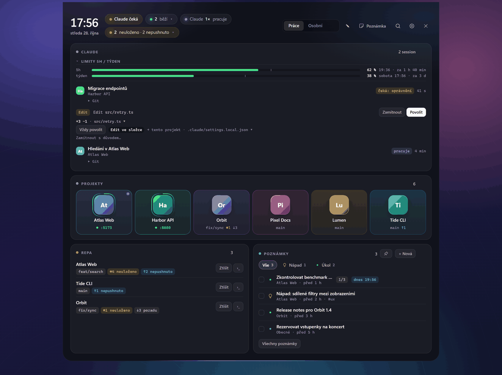
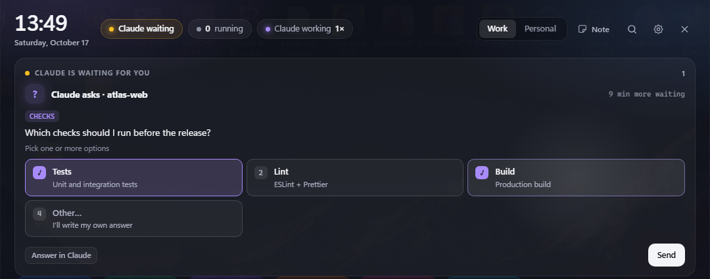
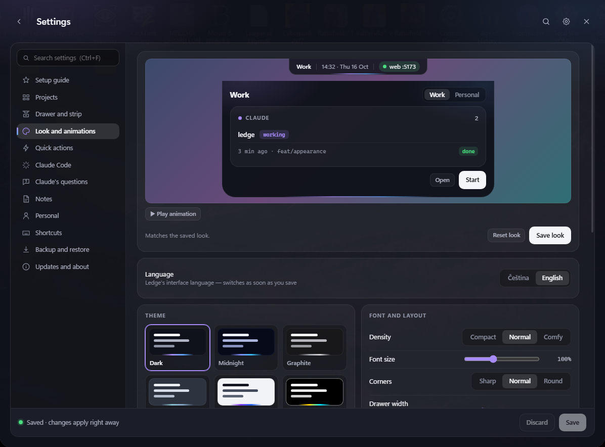

# Ledge

**An always-on drawer at the top edge of your Windows screen** — your projects and dev servers, every
running Claude Code session, notes and quick actions, one mouse move away. It never steals focus and goes
quiet while a fullscreen game is running.

[Česky](README.cs.md) · [Download the latest release](https://github.com/jiri-hyan/ledge-app/releases/latest) ·
[For agents](AGENTS.md)



## What it does

- **Projects.** One tile per project: a click starts its dev server (`npm run dev`, port handling, log) or
  launches its app. Logos are detected from the project itself (favicon, web manifest, app icon). Running
  servers have their own card with Open / Stop; projects missing on this PC can be cloned with one click.
- **Claude Code sessions.** Every Claude Code session on the PC — desktop app and CLI, with subagents —
  with its state: waiting for you, working, idle, unfinished work. A click switches to that window (or
  resumes a finished session in a terminal).
- **Approvals and questions from Claude.** Permission requests and `AskUserQuestion` prompts appear in
  the drawer (a peek opens without taking focus). You answer with a click — single choice, multiple choice
  or your own text. Only a human can approve; there is deliberately no API for it.
- **Notes.** Quick Markdown notes with categories, tasks (`- [ ]`), images, reminders and per-project
  filing. Plain `.md` files in a folder you own; optional sync between PCs through your own private git
  repo.
- **Quick actions and command palette.** Tiles for websites, folders, files, apps and commands, all
  searchable with `Ctrl+K`. Commands and apps with arguments always ask before running until you grant
  consent in Settings.
- **Personal tab.** Clock, weather (Open-Meteo) and your links, separate from work.
- **Looks.** Six themes (dark, midnight, graphite, nord, light, high contrast), accent colour, density,
  font size, corner radius, translucency, motion style and speed, strip style and position.
- **Setup guide.** On first run a short guide finds your repos, picks apps from the Start menu, connects
  Claude Code hooks, and sets language and theme. Nothing is pre-filled with anyone else's data.
- **Czech and English** UI, switchable in Settings → Look and animations.

**Claude asks, you answer from the drawer** — single or multiple choice, or your own text:



**Settings** — everything is configurable, with search and a live preview of the look:



## Install

1. Download `Ledge_<version>_x64-setup.exe` from
   [Releases](https://github.com/jiri-hyan/ledge-app/releases/latest) and run it. It installs for the current
   user into `%LOCALAPPDATA%\Ledge` — no admin rights needed.
2. Windows SmartScreen may warn that the publisher is unknown (the installer is not code-signed):
   **More info → Run anyway**. Each release lists the installer's SHA256 so you can check it.
3. Move the mouse to the top edge of the screen. The setup guide opens on first run.

Requirements: Windows 10 or 11 (x64) with the Microsoft Edge WebView2 runtime (preinstalled on
Windows 11). Claude Code is optional — without it Ledge is a project launcher, notes and quick actions.

**Updates.** Ledge checks the public GitHub releases of this repo and shows a "New version" chip. It
never installs on its own: you click, it downloads the installer from GitHub over HTTPS, verifies the
SHA256 and only then runs it.

**Set up with Claude.** Send Claude the link
`https://github.com/jiri-hyan/ledge-app/releases/latest/download/pro-claude.md` ("Install and set up Ledge for me
using this guide"). Claude installs Ledge, connects to it over MCP, asks what you use and sets up shortcuts,
links and layout for the way you work — after you approve. The connection is off until you turn it on in the
setup guide or in Settings → Claude (MCP), and you can turn it off any time. The guide is
[`docs/pro-claude.md`](docs/pro-claude.md).

**Uninstall.** Windows Settings → Apps → Ledge. Your config (`%APPDATA%\Ledge`) and notes stay.

## Settings

Everything is configurable in Settings (gear icon in the drawer) — projects with auto-detection and
drag-to-reorder, drawer and strip behaviour, Claude Code and hooks, notes and sync, quick actions,
shortcuts, look and language, backup (export / import with a choice of sections / reset) and updates.
Settings has search (`Ctrl+F`) and shows validation errors right at the field.

Under the hood it is one file, `%APPDATA%\Ledge\config.json`, with a generated
`config.schema.json` next to it. Changes apply immediately. An invalid file is never applied and never
silently replaced — Ledge keeps the last good version and backs the broken file up before any write.

## Privacy

- **No telemetry, no account, no cloud.** Ledge talks to the network only for:
  the update check (`api.github.com`, this repo's releases, every 6 hours by default — can be turned off),
  weather (`api.open-meteo.com`, only when you set a location), a one-time favicon download for a website
  quick action, and git sync of notes (only to the remote you configure).
- The local API listens on `127.0.0.1` only and rejects browser requests.
- Claude Code integration reads the session list from `claude agents` and receives hook events locally.
  Ledge never approves anything on its own.
- Notes are plain files in your folder (`%USERPROFILE%\Ledge\notes` by default).

## For agents

Ledge is designed to be configured by AI agents as well as by hand. [`AGENTS.md`](AGENTS.md) describes
the config, the note file format, the local API and the rules (for example: agents may add projects,
actions and notes, but approvals are human-only). Code maps for contributors live in
[`docs/codemap/`](docs/codemap/README.md).

## Build from source

```
corepack pnpm install
corepack pnpm tauri dev          # development
cd src-tauri && cargo test       # Rust tests
corepack pnpm test:ui            # UI logic tests
powershell -File scripts/release.ps1   # NSIS installer
```

Stack: Tauri 2, Rust, SolidJS, TypeScript. Performance budget: idle CPU below 0.1 %, `ledge.exe` below
25 MB private memory (measured with `scripts/perf.ps1`).

## License

[MIT](LICENSE)
